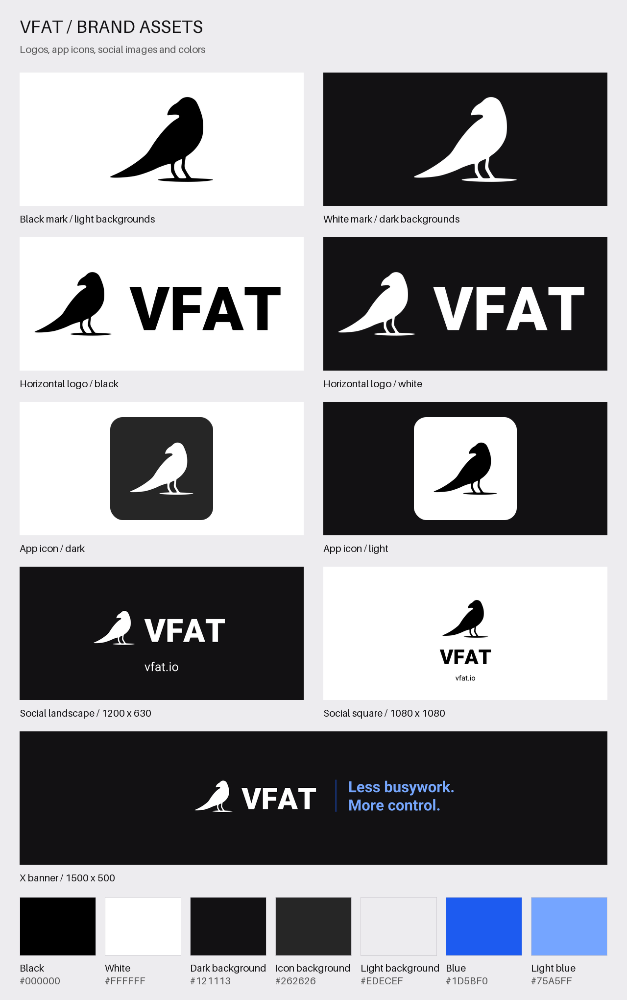

# VFAT brand assets

Official VFAT logos, app icons, and social images for app integrations, referral links, partner announcements, and posts about VFAT.

**[Download the complete kit](https://github.com/vfat-io/brand-assets/releases/latest/download/vfat-brand-assets.zip)** · **[Usage guide](USAGE.md)** · **[VFAT](https://vfat.io)** · **[X / @vfat_io](https://x.com/vfat_io)**



## Choose an asset

| Use | Recommended asset | Downloads |
| --- | --- | --- |
| Logo on a light background | Black bird, transparent | [SVG](logos/mark/vfat-mark-black.svg) · [PNG 512](logos/mark/vfat-mark-black-512.png) · [PNG 1024](logos/mark/vfat-mark-black-1024.png) |
| Logo on a dark background | White bird, transparent | [SVG](logos/mark/vfat-mark-white.svg) · [PNG 512](logos/mark/vfat-mark-white-512.png) · [PNG 1024](logos/mark/vfat-mark-white-1024.png) |
| Integration page or partner list | Bird + VFAT horizontal logo | [Black SVG](logos/horizontal/vfat-logo-black.svg) · [Black PNG](logos/horizontal/vfat-logo-black-2048.png) · [White SVG](logos/horizontal/vfat-logo-white.svg) · [White PNG](logos/horizontal/vfat-logo-white-2048.png) |
| Referral button, app directory, or compact card | Square app icon | [Dark SVG](icons/vfat-icon-dark.svg) · [Dark PNG 512](icons/vfat-icon-dark-512.png) · [Light SVG](icons/vfat-icon-light.svg) · [Light PNG 512](icons/vfat-icon-light-512.png) |
| Landscape social post or link preview | 1200 × 630 image | [Dark PNG](social/vfat-social-landscape-dark.png) · [Light PNG](social/vfat-social-landscape-light.png) |
| Square social post | 1080 × 1080 image | [Dark PNG](social/vfat-social-square-dark.png) · [Light PNG](social/vfat-social-square-light.png) |
| X profile header | 1500 × 500 banner | [Dark PNG](social/vfat-x-banner-dark.png) · [Light PNG](social/vfat-x-banner-light.png) |

SVGs scale to any size and have outlined lettering: no font installation is required. PNG logos have transparent backgrounds. Square icons have rounded, transparent corners; social images have solid backgrounds. A white logo may appear blank in a white image viewer.

Additional PNG sizes: marks at 256, 512, and 1024 px; horizontal logos at 512, 1024, and 2048 px wide; icons at 64, 128, 256, 512, and 1024 px. Each social PNG has an [editable SVG companion](social/).

## Use in an app

Download and serve the asset from your own app for production. For a direct link, use a versioned raw URL:

```html
<a href="https://vfat.io" aria-label="Open VFAT">
  
</a>
```

Use your existing VFAT referral URL as the link destination when applicable. This kit does not create referral codes or define referral URL parameters.

Use `alt="VFAT"` for a standalone logo, or `alt=""` when adjacent text already names VFAT. Prefer SVG for scalable UI; use PNG for social uploads or tools that do not support SVG.

## Stable links and downloads

- [Complete ZIP](https://github.com/vfat-io/brand-assets/releases/latest/download/vfat-brand-assets.zip): a convenient shareable download for designers and partners.
- [Version 1.1.0](https://github.com/vfat-io/brand-assets/releases/tag/v1.1.0): a fixed kit version for integrations.
- [Asset manifest](manifest.json): filenames, dimensions, backgrounds, and SHA-256 checksums. Append each `path` to `base_url` for its versioned raw URL.
- [Release history](https://github.com/vfat-io/brand-assets/releases): changes and downloadable versions.

Files on `main` may evolve. Use a release tag or commit SHA when you need fixed assets.

## Colors and type

| Color | Value | Key | Use |
| --- | --- | --- | --- |
| Black | `#000000` | `black` | Logo and text on light backgrounds |
| White | `#FFFFFF` | `white` | Logo and text on dark backgrounds; text on Blue |
| Dark background | `#121113` | `social-background` | Social images and VFAT's dark theme |
| Icon background | `#262626` | `icon-background` | Dark app icon |
| Light background | `#EDECEF` | `light-background` | VFAT's light theme |
| Blue | `#1D5BF0` | `accent` | Buttons, links, and accents |
| Light blue | `#75A5FF` | `accent-on-dark` | Blue text on dark backgrounds |

Contrast for text:

- White on Blue: 5.5:1, so white labels work on Blue buttons.
- Blue on white: 5.5:1; on Light background: 4.7:1.
- Light blue on Dark background: 7.7:1. Blue on Dark background is 3.4:1: use it there for large text, rules, and fills, not body text.

The logo stays black or white; the blues are supporting colors. Typography is Roboto: the horizontal logo pairs the bird with outlined Roboto Black lettering. Machine-readable values are in [colors.json](colors.json), and as CSS custom properties, such as `--vfat-accent`, in [colors.css](colors.css). Copy the file into your project rather than linking to it.

## Usage and maintenance

Use these assets to identify or refer to VFAT accurately. See [USAGE.md](USAGE.md) for layout guidance and [LICENSE.md](LICENSE.md) for the brand asset permission.

For another format or a correction, [open an issue](https://github.com/vfat-io/brand-assets/issues/new). Maintainers can find asset provenance and export instructions in [SOURCES.md](SOURCES.md).
